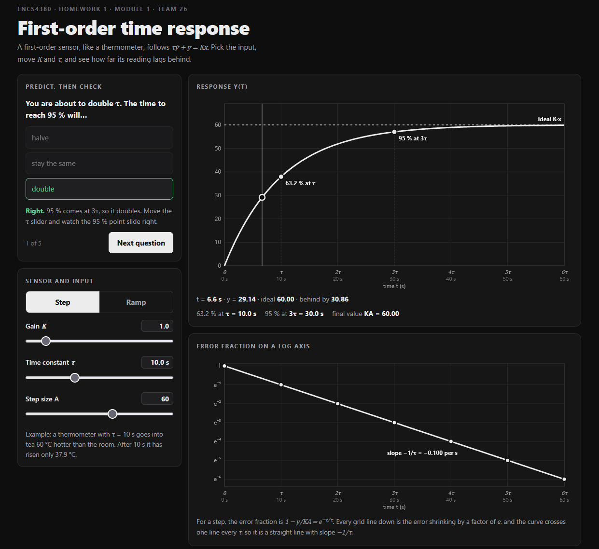

Module 1: First-order time response

Module 1 is finished in index.html. It runs live in the browser using plain JavaScript and custom SVG plots, with no external libraries.

What was built:
- Sliders for K, tau and A, and Step / Ramp buttons to switch the input.
- Step response plot with markers at 63.2% (t = tau) and 95% (t = 3 tau).
- Ramp response plot showing the lag (tau) and the steady-state error (K*A*tau).
- Error-fraction plot on a log axis, with the slope -1/tau.
- "Predict, then check" quiz with 5 multiple-choice questions.
- Validation check 1 table with expected value, measured value and pass/fail. Both checks pass.
