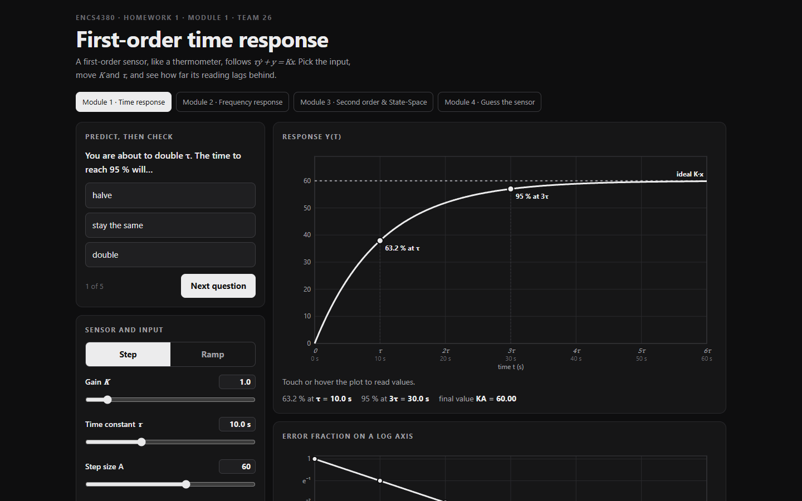
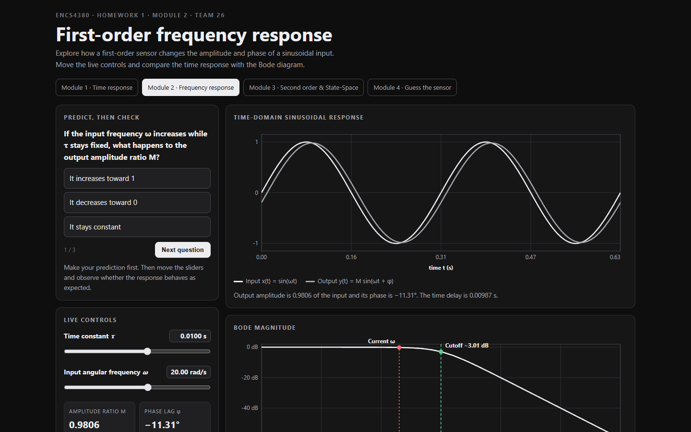
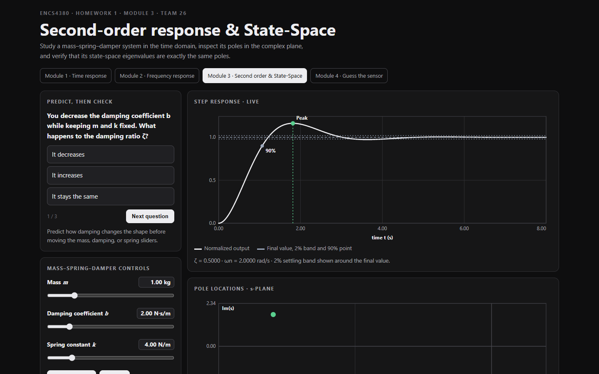
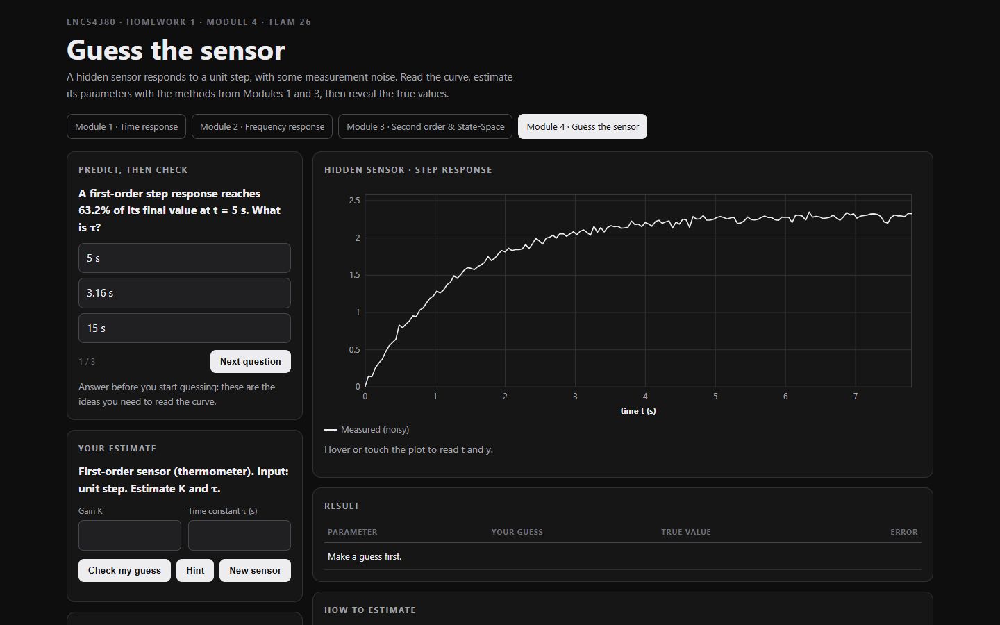
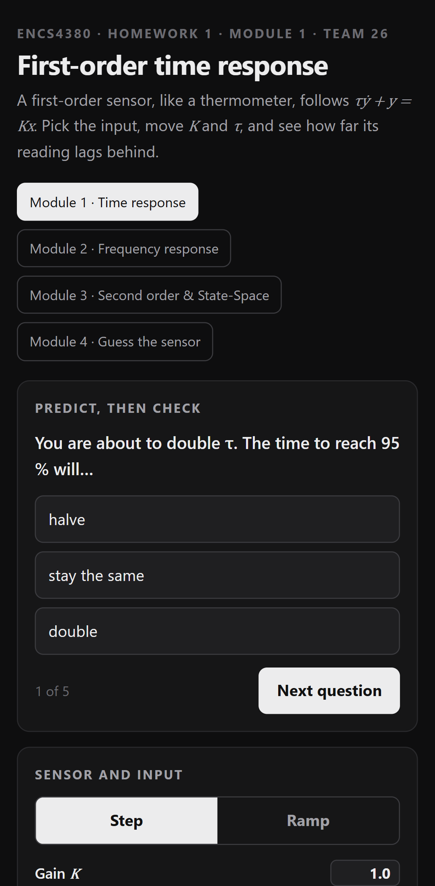

# ENCS4380 Dynamics — Team 26

Interactive browser-based demonstrations for first-order and second-order dynamic systems.

## Live project

- [Module 1 — First-order time response](module1.html)
- [Module 2 — First-order frequency response](module2.html)
- [Module 3 — Second-order response & State-Space](module3.html)
- [Module 4 — Guess the sensor](module4.html)

## Live project

| Module | Live page |
|---|---|
| Module 1 — First-order time response | https://3mrra.github.io/ENCS4380-Dynamics-Team-26/module1.html |
| Module 2 — First-order frequency response | https://3mrra.github.io/ENCS4380-Dynamics-Team-26/module2.html |
| Module 3 — Second-order response & State-Space | https://3mrra.github.io/ENCS4380-Dynamics-Team-26/module3.html |
| Module 4 — Guess the sensor | https://3mrra.github.io/ENCS4380-Dynamics-Team-26/module4.html |

## Team

| Member | GitHub | Built |
|---|---|---|
| Omar Rabieh | [@3mrRa](https://github.com/3mrRa) | Modules 1, 2 and 3 |
| Omar Takhman | [@omarta5man](https://github.com/omarta5man) | Modules 1, 2 and 3 |
| Baraa Halaseh | [@BraaHalaseh](https://github.com/BraaHalaseh) | Module 3 and 4 |
| Anas | [@Anas-MAD-h](https://github.com/Anas-MAD-h) | — |

## Screenshots

**Module 1 — First-order time response**

**Module 2 — First-order frequency response**

**Module 3 — Second-order response & State-Space**

**Module 4 — Guess the sensor**

**On a phone (Module 1)**

## Modules

### Module 1 — First-order time response
- Step and ramp input selection.
- Live controls for gain, time constant, and input amplitude/ramp rate.
- Time-response and logarithmic error plots.
- Predict, then check quiz and validation checks.

### Module 2 — First-order frequency response
- Live time constant and input angular-frequency sliders.
- Input/output sine-wave comparison.
- Live amplitude ratio, phase lag, cutoff frequency, and dynamic error.
- Bode magnitude and phase plots with the cutoff frequency marked.
- Validation checks for Check 2 and Check 3.

### Module 3 — Second-order response & State-Space
- Mass, damping, and spring-constant sliders.
- Underdamped, critically damped, and overdamped step responses.
- Rise time, peak time, overshoot, and 2% settling time.
- Pole locations in the s-plane.
- Live state-space A and B matrices, eigenvalues, and phase-plane trajectory.
- Validation checks for Check 4, Check 5, and Check 6.

### Module 4 — Guess the sensor
- A hidden sensor is picked at random: first order (K, τ) or second order (ζ, ωn), with measurement noise.
- The user reads the noisy step response (live t / y readout under the mouse) and enters an estimate.
- Reveal: true values, error per parameter, true curve and guessed curve drawn on the plot.
- Scoring: 50 points per parameter, full marks within 10 %, a running session score, hints on request and a New sensor button.
- ζ is drawn between 0.1 and 0.8 so the response always overshoots and the overshoot method can be used.

## Implementation

The project uses plain HTML, CSS, and JavaScript with SVG plots. No external charting libraries or build step are required. Open the html file locally, or use the GitHub Pages deployment configured for this repository.

## Team

ENCS4380 · Interfacing Techniques · Team 26

## AI use

Module 1-4 was written with help from an AI assistant, which explained the estimation methods and helped write the page code. 
