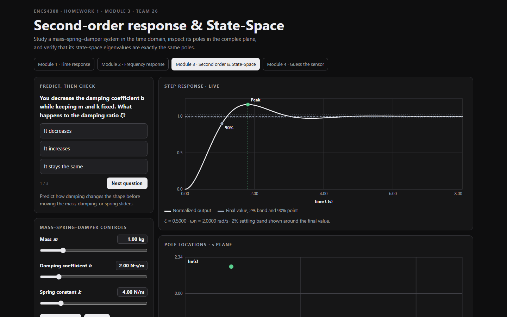
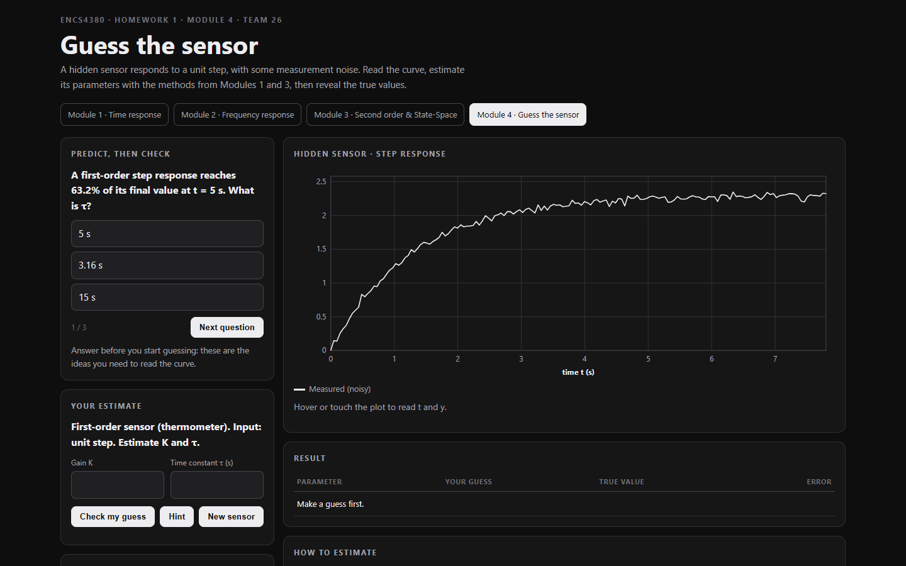
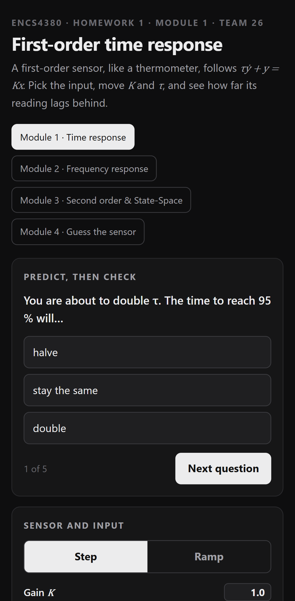

# ENCS4380 Dynamics — Team 26

Interactive browser-based demonstrations for first-order and second-order dynamic systems.

## Live project

**Live site:** https://3mrra.github.io/ENCS4380-Dynamics-Team-26/

| Module | Live page |
|---|---|
| Module 1 — First-order time response | https://3mrra.github.io/ENCS4380-Dynamics-Team-26/ |
| Module 2 — First-order frequency response | https://3mrra.github.io/ENCS4380-Dynamics-Team-26/module2.html |
| Module 3 — Second-order response & State-Space | https://3mrra.github.io/ENCS4380-Dynamics-Team-26/module3.html |
| Module 4 — Guess the sensor | https://3mrra.github.io/ENCS4380-Dynamics-Team-26/module4.html |
| Homework 2 — P1 PID Playground | https://3mrra.github.io/ENCS4380-Dynamics-Team-26/pid.html |
| Homework 2 — P2 A slow sensor in the loop | https://3mrra.github.io/ENCS4380-Dynamics-Team-26/sensor.html |

## Team

| Member | GitHub | Built |
|---|---|---|
| Omar Rabieh | [@3mrRa](https://github.com/3mrRa) | Module 1 (with Omar Takhman and Anas), Module 2 (with Omar Takhman), Module 3 (with Omar Takhman), Homework 2 P2 (slow sensor in the loop) |
| Omar Takhman | [@omarta5man](https://github.com/omarta5man) | Module 1 (with Omar Rabieh and Anas), Module 2 (with Omar Rabieh), Module 3 (with Omar Rabieh) |
| Anas | [@Anas-MAD-h](https://github.com/Anas-MAD-h) | Module 1 (with Omar Rabieh and Omar Takhman) |
| Baraa Halaseh | [@BraaHalaseh](https://github.com/BraaHalaseh) | Module 4 |

## Screenshots

**Module 1 — First-order time response**

**Module 2 — First-order frequency response**

**Module 3 — Second-order response & State-Space**

**Module 4 — Guess the sensor**

**On a phone (Module 1)**

## Modules

### Module 1 — First-order time response
- Step and ramp input selection.
- Live controls for gain, time constant, and input amplitude/ramp rate.
- Time-response and logarithmic error plots.
- Predict, then check quiz and validation checks.

### Module 2 — First-order frequency response
- Live time constant and input angular-frequency sliders.
- Input/output sine-wave comparison.
- Live amplitude ratio, phase lag, cutoff frequency, and dynamic error.
- Bode magnitude and phase plots with the cutoff frequency marked.
- Validation checks for Check 2 and Check 3.

### Module 3 — Second-order response & State-Space
- Mass, damping, and spring-constant sliders.
- Underdamped, critically damped, and overdamped step responses.
- Rise time, peak time, overshoot, and 2% settling time.
- Pole locations in the s-plane.
- Live state-space A and B matrices, eigenvalues, and phase-plane trajectory.
- Validation checks for Check 4, Check 5, and Check 6.

### Module 4 — Guess the sensor
- A hidden sensor is picked at random: first order (K, τ) or second order (ζ, ωn), with measurement noise.
- The user reads the noisy step response (live t / y readout under the mouse) and enters an estimate.
- Reveal: true values, error per parameter, true curve and guessed curve drawn on the plot.
- Scoring: 50 points per parameter, full marks within 10 %, a running session score, hints on request and a New sensor button.
- ζ is drawn between 0.1 and 0.8 so the response always overshoots and the overshoot method can be used.

### Homework 2 — P1 PID Playground
- First-order and second-order plant selection with adjustable plant parameters. Wide ranges (K 0.1–20, τ 0.02–10 s) and number boxes for typing measured values; the time window follows the plant's speed.
- Live SVG block diagram (r, Σ, PID, 0–100% actuator limit, plant G(s), negative feedback) labelled with the current gains and plant.
- Live PID gain and setpoint controls.
- Closed-loop output and saturated control-effort plots.
- Rise time, overshoot, 2% settling time, and steady-state error metrics.
- Forward Euler numerical simulation with 0–100% actuator saturation and conditional integral anti-windup. Steps are subdivided automatically when the gains make the loop fast, so Euler stays stable.
- Predict, then check quiz on what P, I and D do.
- Validation checks 1–3 from the handout (K = 1, τ = 1 s), run through the same solver, with buttons that load checks 1 and 2 into the playground.

### Homework 2 — P2 A slow sensor in the loop
- First-order sensor 1/(τs·s + 1) in the feedback path; the controller only sees the sensor reading y_m (e = r − y_m).
- Sensor τs on a log slider (0.01–10 s), plant K and τ, setpoint, Kp, Ki, Kd, with number boxes for exact values; actuator limit 0–100% can be switched off to see the linear loop.
- True output y and sensor reading y_m on the same plot, control signal plot, live block diagram with the sensor block.
- Verdict (settled / dying out / limit cycle / growing), overshoot of y vs overshoot the sensor shows, settling time and oscillation period.
- Stability card: characteristic equation, closed-loop poles, Routh test and the critical sensor time constant τs,crit = (τ + K·Kd)(1 + K·Kp) / (τ·K·Ki − (1 + K·Kp)).
- Sweep chart of overshoot against τs with the unstable region shaded; presets for fast, near-critical and oscillating sensors.
- RK4 solver (Euler adds false growth to oscillations, which moves the edge of stability); derivative on the sensor reading uses dy_m/dt = (y − y_m)/τs exactly.
- Predict, then check quiz and 6 validation checks against the formulas (sensor overshoot, τs,crit, oscillation period, effect of Kd, zero steady-state error).

## Implementation

The project uses plain HTML, CSS, and JavaScript with SVG plots. No external charting libraries or build step are required. Open the html file locally, or use the GitHub Pages deployment configured for this repository.

## AI use

Module 1-4 were written with help from an AI assistant, which explained the estimation methods and helped write the page code. 
