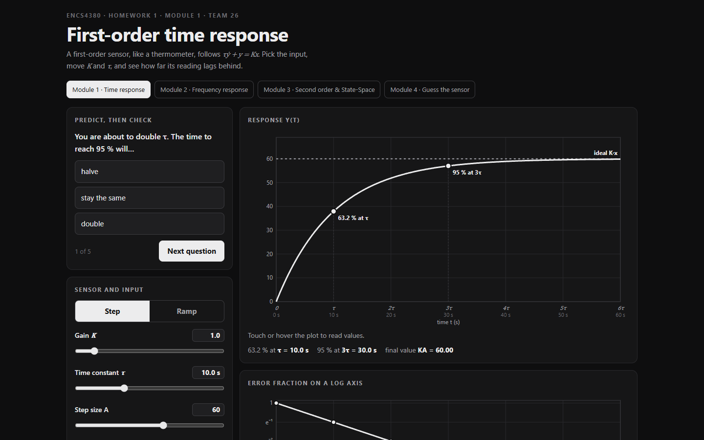
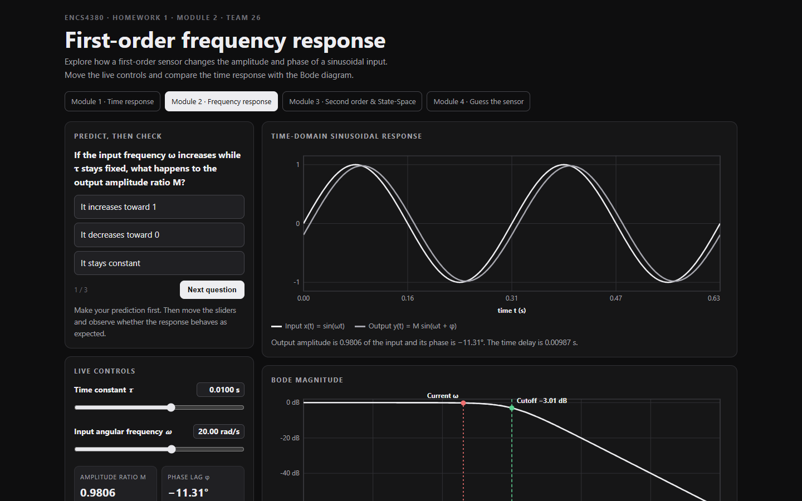
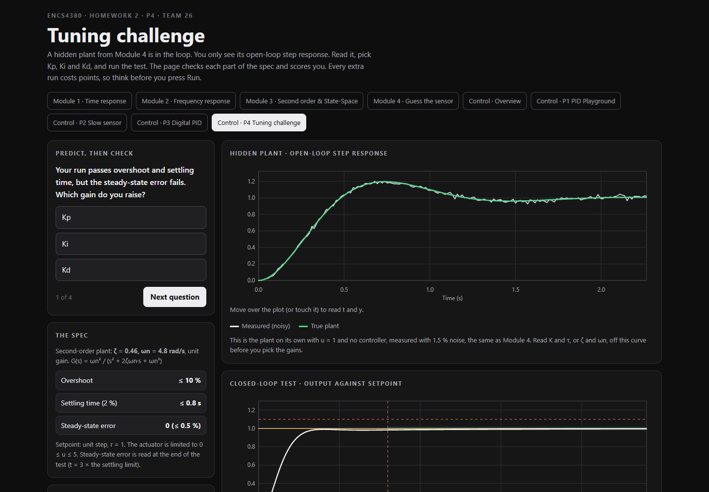

# ENCS4380 Dynamics — Team 26

Interactive browser-based demonstrations for first-order and second-order dynamic systems (Homework 1) and for PID feedback control (Homework 2).

## Live project

**Live site:** https://3mrra.github.io/ENCS4380-Dynamics-Team-26/

| Module | Live page |
|---|---|
| Module 1 — First-order time response | https://3mrra.github.io/ENCS4380-Dynamics-Team-26/ |
| Module 2 — First-order frequency response | https://3mrra.github.io/ENCS4380-Dynamics-Team-26/module2.html |
| Module 3 — Second-order response & State-Space | https://3mrra.github.io/ENCS4380-Dynamics-Team-26/module3.html |
| Module 4 — Guess the sensor | https://3mrra.github.io/ENCS4380-Dynamics-Team-26/module4.html |
| Control — Overview of Homework 2 | https://3mrra.github.io/ENCS4380-Dynamics-Team-26/control.html |
| Homework 2 — P1 PID Playground | https://3mrra.github.io/ENCS4380-Dynamics-Team-26/pid.html |
| Homework 2 — P2 A slow sensor in the loop | https://3mrra.github.io/ENCS4380-Dynamics-Team-26/sensor.html |
| Homework 2 — P3 Digital PID | https://3mrra.github.io/ENCS4380-Dynamics-Team-26/digital.html |
| Homework 2 — P4 Tuning challenge | https://3mrra.github.io/ENCS4380-Dynamics-Team-26/tuning.html |

## Team

| Member | GitHub | Built |
|---|---|---|
| Omar Rabieh | [@3mrRa](https://github.com/3mrRa) | Module 1 (with Omar Takhman and Anas), Module 2 (with Omar Takhman), Module 3 (with Omar Takhman), Homework 2 P1 (fixes, validation checks and block diagram, with Anas), Homework 2 P2 (slow sensor in the loop) |
| Omar Takhman | [@omarta5man](https://github.com/omarta5man) | Module 1 (with Omar Rabieh and Anas), Module 2 (with Omar Rabieh), Module 3 (with Omar Rabieh), Homework 2 P4 (tuning challenge), Control overview page |
| Anas | [@Anas-MAD-h](https://github.com/Anas-MAD-h) | Module 1 (with Omar Rabieh and Omar Takhman), Homework 2 P1 (PID playground, with Omar Rabieh) |
| Baraa Halaseh | [@BraaHalaseh](https://github.com/BraaHalaseh) | Module 4, Homework 2 P3 (digital PID) |

## Screenshots

**Module 1 — First-order time response**

**Module 2 — First-order frequency response**

**Module 3 — Second-order response & State-Space**

**Module 4 — Guess the sensor**

**Homework 2 — P4 Tuning challenge**

**On a phone (Module 1)**

## Modules

### Module 1 — First-order time response
- Step and ramp input selection.
- Live controls for gain, time constant, and input amplitude/ramp rate.
- Time-response and logarithmic error plots.
- Predict, then check quiz and validation checks.

### Module 2 — First-order frequency response
- Live time constant and input angular-frequency sliders.
- Input/output sine-wave comparison.
- Live amplitude ratio, phase lag, cutoff frequency, and dynamic error.
- Bode magnitude and phase plots with the cutoff frequency marked.
- Validation checks for Check 2 and Check 3.

### Module 3 — Second-order response & State-Space
- Mass, damping, and spring-constant sliders.
- Underdamped, critically damped, and overdamped step responses.
- Rise time, peak time, overshoot, and 2% settling time.
- Pole locations in the s-plane.
- Live state-space A and B matrices, eigenvalues, and phase-plane trajectory.
- Validation checks for Check 4, Check 5, and Check 6.

### Module 4 — Guess the sensor
- A hidden sensor is picked at random: first order (K, τ) or second order (ζ, ωn), with measurement noise.
- The user reads the noisy step response (live t / y readout under the mouse) and enters an estimate.
- Reveal: true values, error per parameter, true curve and guessed curve drawn on the plot.
- Scoring: 50 points per parameter, full marks within 10 %, a running session score, hints on request and a New sensor button.
- ζ is drawn between 0.1 and 0.8 so the response always overshoots and the overshoot method can be used.

### Control — Overview of Homework 2
- The Control section, linked from every page's menu, including the landing page.
- One card per module (P1–P4): what it shows, what you can change, and a link to it.
- The digital PID equation and the three validation checks from the handout.

### Homework 2 — P1 PID Playground
- First-order and second-order plant selection with adjustable plant parameters. Wide ranges (K 0.1–20, τ 0.02–10 s) and number boxes for typing measured values; the time window follows the plant's speed.
- Live SVG block diagram (r, Σ, PID, 0–100% actuator limit, plant G(s), negative feedback) labelled with the current gains and plant.
- Live PID gain and setpoint controls.
- Closed-loop output and saturated control-effort plots.
- Rise time, overshoot, 2% settling time, and steady-state error metrics.
- Forward Euler numerical simulation with 0–100% actuator saturation and conditional integral anti-windup. Steps are subdivided automatically when the gains make the loop fast, so Euler stays stable.
- Predict, then check quiz on what P, I and D do.
- Validation checks 1–3 from the handout (K = 1, τ = 1 s), run through the same solver, with buttons that load checks 1 and 2 into the playground.

### Homework 2 — P2 A slow sensor in the loop
- First-order sensor 1/(τs·s + 1) in the feedback path; the controller only sees the sensor reading y_m (e = r − y_m).
- Sensor τs on a log slider (0.01–10 s), plant K and τ, setpoint, Kp, Ki, Kd, with number boxes for exact values; actuator limit 0–100% can be switched off to see the linear loop.
- True output y and sensor reading y_m on the same plot, control signal plot, live block diagram with the sensor block.
- Verdict (settled / dying out / limit cycle / growing), overshoot of y vs overshoot the sensor shows, settling time and oscillation period.
- Stability card: characteristic equation, closed-loop poles, Routh test and the critical sensor time constant τs,crit = (τ + K·Kd)(1 + K·Kp) / (τ·K·Ki − (1 + K·Kp)).
- Sweep chart of overshoot against τs with the unstable region shaded; presets for fast, near-critical and oscillating sensors.
- RK4 solver (Euler adds false growth to oscillations, which moves the edge of stability); derivative on the sensor reading uses dy_m/dt = (y − y_m)/τs exactly.
- Predict, then check quiz and 6 validation checks against the formulas (sensor overshoot, τs,crit, oscillation period, effect of Kd, zero steady-state error).

### Homework 2 — P3 Digital PID
- The PID runs only every Ts seconds, as it would on an Arduino: u[k] = Kp·e[k] + Ki·Ts·Σe[j] + Kd·(e[k] − e[k−1])/Ts, held constant between samples (zero-order hold) and clamped to 0–100 %.
- Ts on a log slider (1 ms to 2 s), Kp, Ki, Kd, first-order plant K and τ from Module 1, setpoint, with number boxes for exact values.
- Output of the digital loop drawn over the continuous PID (Ts → 0); stair-step control signal with the actuator limits.
- Digital vs continuous metrics (rise time, overshoot, 2 % settling time, steady-state error).
- "How performance falls as Ts grows": overshoot against Ts/τ and a table from 0.01τ to τ with the current Ts marked.
- Anti-windup on/off (the error sum stops growing while u is at a limit and the error pushes further), with a Windup demo preset.
- Arduino loop code generated for the current gains, Ts and anti-windup setting, with a Copy button. It uses the same equation, clamp and anti-windup rule as the simulation.
- Plant stepped with forward Euler in sub-steps of at most τ/100 between samples, so the only difference from the continuous loop is the sampling.
- Predict, then check quiz on Ts, windup and the digital integral and derivative.

### Homework 2 — P4 Tuning challenge
- A hidden random plant from Module 4 (same ranges and models): first order (K 0.5–5, τ 0.5–10 s) or second order (ζ 0.1–0.8, ωn 0.5–6 rad/s, unit gain).
- Its noisy open-loop step response is shown as the clue, with a t / y readout under the mouse or finger, so K and τ (or ζ and ωn) can be read off it as in Module 4.
- The user changes only Kp, Ki and Kd (sliders and number boxes), then presses Run test.
- Spec for a unit step: overshoot ≤ 10 %, 2 % settling time within a limit (2τ for first order, 4/ωn for second order, half of what the plant needs on its own) and zero steady-state error (≤ 0.5 % at the end of the test). Actuator limited to 0 ≤ u ≤ 5.
- Pass or fail on each part of the spec, drawn on the plot as the overshoot limit, the settling-time line and the ±2 % band; control signal plot with the actuator limits.
- Score: 35 points for overshoot, 35 for settling time, 30 for steady-state error, minus 10 for each run after the first. The round keeps the best run; a session total runs across plants. Hints, Show the plant and New plant buttons; after a round the true plant is drawn on the clue and the gains can be moved freely for practice.
- Closed loop stepped with RK4, with sub-steps when the gains make the loop fast, conditional anti-windup, and the derivative on the output (no kick at the setpoint step). A solver check compares RK4 with the exact answers for P only (Kp = 9) and PI (Kp = Ki = 1).
- Tested on 160 random plants: every plant has gains that pass the whole spec, and the starting gains never pass.
- Predict, then check quiz on which gain fixes which part of the spec.

## Implementation

The project uses plain HTML, CSS, and JavaScript with SVG plots. No external charting libraries or build step are required. The Homework 2 modules simulate the closed loop with their own solvers (forward Euler in P1 and P3, RK4 in P2 and P4). Open the html file locally, or use the GitHub Pages deployment configured for this repository.

## AI use

Module 1-4 were written with help from an AI assistant, which explained the estimation methods and helped write the page code.

Homework 2 P3 (digital PID) was written with help from an AI assistant (Claude), which explained digital PID, sampling time and anti-windup, and helped write the page code. The page reuses the team's plot helper, metrics and input pattern from P1 and P2.

Homework 2 P4 (tuning challenge) and the Control overview page were written with help from an AI assistant (Claude), which explained PID tuning and RK4 and helped write the page code. P4 reuses the hidden plant from Module 4 and the plot, input and quiz pattern from P1.
